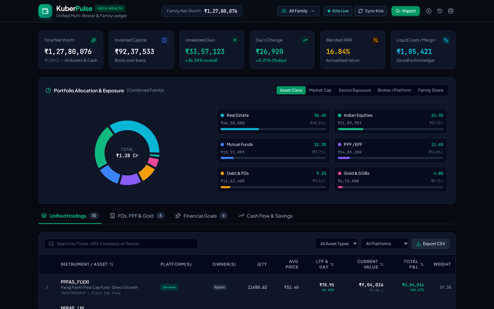
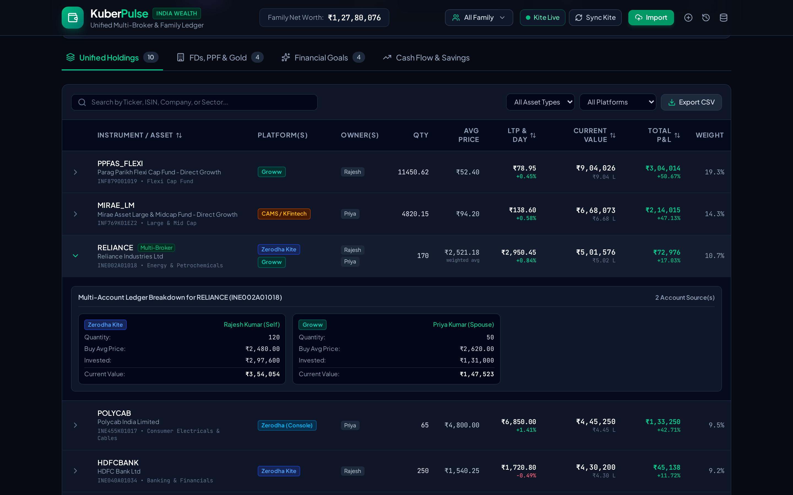
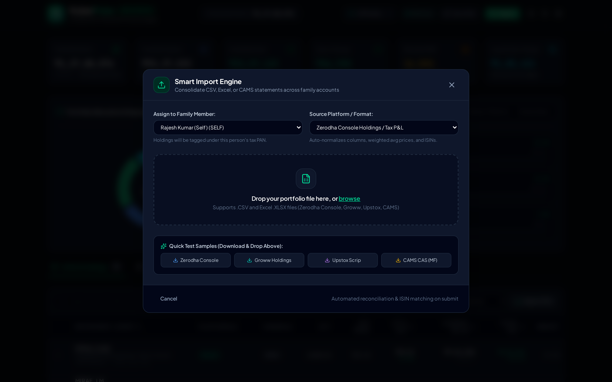
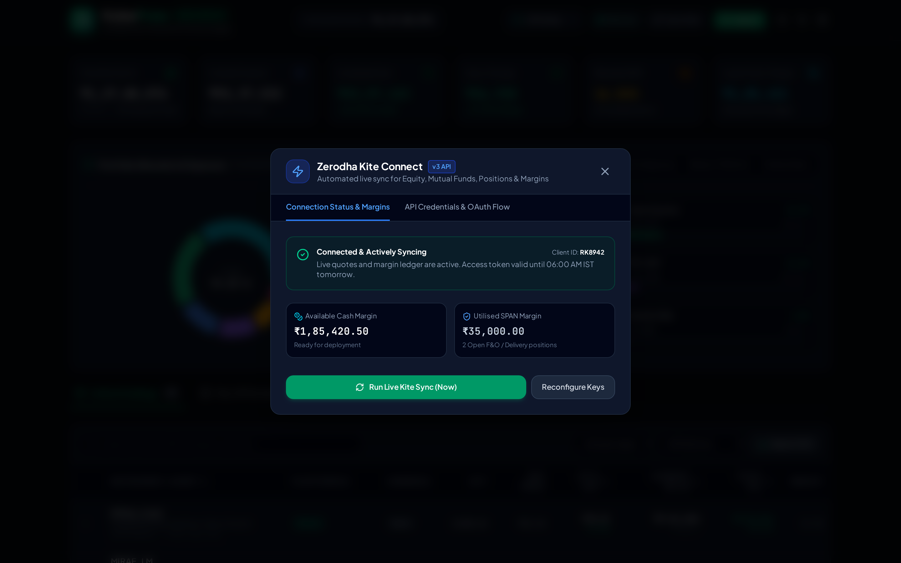
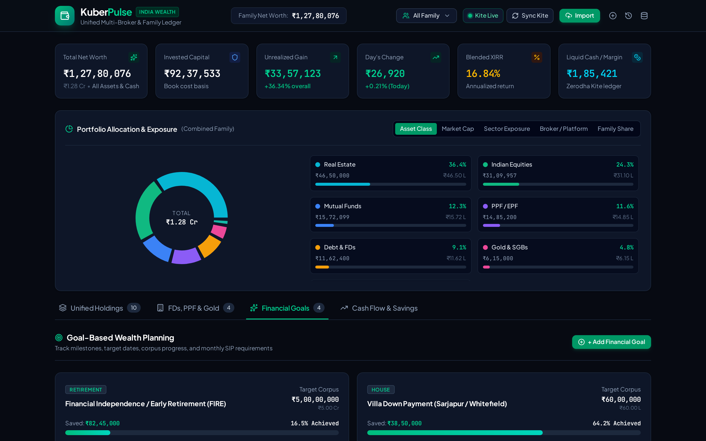
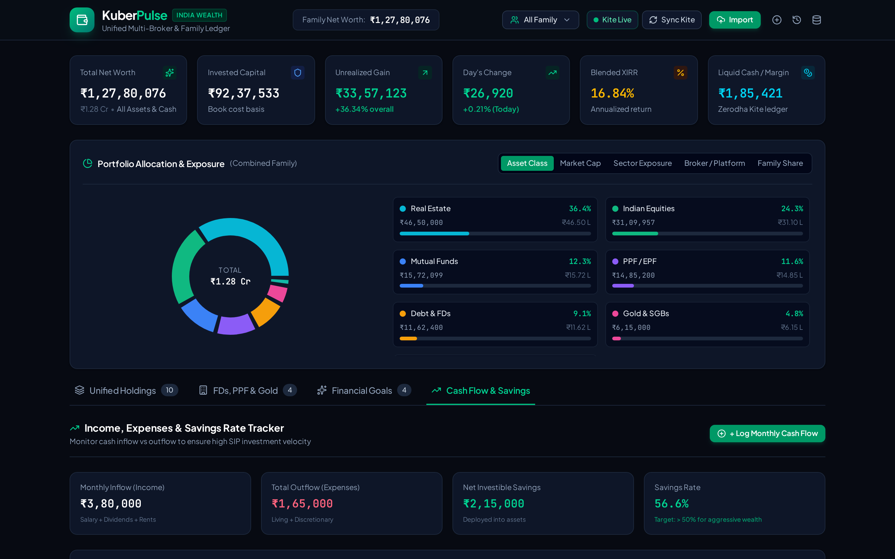

# KuberPulse — Indian Wealth & Multi-Broker Portfolio Tracker

**KuberPulse** is a unified personal finance and wealth management web application tailored for Indian retail investors and families. It consolidates investments across multiple brokers, Mutual Fund RTAs, and non-broker physical/sovereign assets into a single relational ledger with Indian numbering (`₹` en-IN formatting), ISIN-based deduplication, and multi-PAN family tagging.

---

## App Screenshots

### 1. Unified Wealth Dashboard & Asset Allocation
Top summary KPI cards (**Total Net Worth**, **Invested Capital**, **Unrealized Gain**, **Day's Change**, **Blended XIRR**, and **Liquid Cash Margin**) alongside interactive donut charts segmented by Asset Class, Market Cap, Sector Exposure, Broker/Platform, and Family Share.



### 2. Multi-Broker Holdings & ISIN Deduplication
Searchable and sortable holdings table that automatically merges duplicate securities across platforms (e.g., `RELIANCE` held across both **Zerodha Kite** and **Groww**) using weighted-average buy prices, with expandable per-broker ledger drawers.



### 3. Smart Import Engine (CSV / Excel / CAMS CAS)
Drag-and-drop import wizard supporting **Zerodha Console**, **Groww**, **Upstox**, and **CAMS / KFintech CAS** exports with instant file previews, family member PAN assignment, downloadable test samples, and 1-click batch rollbacks.



### 4. Zerodha Kite Connect v3 Integration
Manage Kite Connect API credentials, inspect available cash and utilised SPAN margins, handle daily 06:00 AM IST token expirations gracefully, and trigger live portfolio syncs.



### 5. Goal-Based Wealth Planning
Track long-term milestones such as Financial Independence (FIRE), Home Down Payment, Children's Education, and Emergency Runway with corpus progress bars, shortfall calculations, and recommended monthly SIPs.



### 6. Cash Flow & Savings Rate Tracker
Log monthly inflows and categorized outflows (Mutual Fund SIPs, Rent/EMI, Groceries, Utilities) to track net investible surplus and savings velocity.



---

## Core Features

* **Zerodha Kite Connect Sync**: OAuth login URL generation, margin inspection, and live sync simulation for equities, ETFs, positions, and cash balances.
* **Multi-Platform Import & Reconciliation**:
  * Parsers for **Zerodha Console**, **Groww**, **Upstox**, and **CAMS / KFintech CAS** via `papaparse` and `xlsx`.
  * Automatic **ISIN & Ticker deduplication** calculating weighted-average buy prices across brokers.
  * **Import Audit & Rollback Logs** allowing instant 1-click undo of any uploaded batch.
* **Family Multi-Profile Tagging**: Segregate and filter holdings across `Self`, `Spouse`, `Parent`, `Child`, and `HUF` accounts, or view the combined family balance sheet.
* **Non-Broker Asset Ledger**: Track **Bank Fixed Deposits (FDs)**, **PPF**, **EPF**, **RBI Sovereign Gold Bonds (SGBs)**, and **Real Estate** with interest rates and maturity dates.
* **Institutional Indian UX**: Dark fintech theme with tabular monospace numerals, `en-IN` Rupee formatting (`₹1,84,25,840`), compact Lakh/Crore notation (`₹1.84 Cr`), and CSV export.
* **PostgreSQL Relational Schema**: Full Prisma schema (`prisma/schema.prisma`) modeling `User`, `FamilyMember`, `BrokerConnection`, `Asset`, `Holding`, `Transaction`, `ManualAsset`, `ImportLog`, `FinancialGoal`, and `CashflowRecord`.

---

## Tech Stack

* **Frontend**: React 19, TypeScript, Vite, Tailwind CSS v4, Lucide Icons
* **Data Visualization**: Recharts (interactive allocation donut charts)
* **File Parsing**: `papaparse` (CSV), `xlsx` (Excel spreadsheets)
* **Database Blueprint**: Prisma ORM (`prisma/schema.prisma`) for PostgreSQL / Supabase

---

## Getting Started

### 1. Install Dependencies
```bash
npm install
```

### 2. Run Development Server
```bash
npm run dev
```
The app runs at `http://localhost:3000`.

### 3. Build for Production
```bash
npm run build
```

### 4. Type Check / Lint
```bash
npm run lint
```

---

## Project Structure

```text
├── prisma/
│   └── schema.prisma                  # PostgreSQL relational schema
├── docs/
│   └── screenshots/                   # Application screenshots
├── src/
│   ├── components/
│   │   ├── architecture/              # Prisma schema & architecture viewer modal
│   │   ├── cashflow/                  # Income vs. expenses & savings rate tracker
│   │   ├── dashboard/                 # Summary KPI cards & allocation charts
│   │   ├── family/                    # Family member PAN profile management
│   │   ├── goals/                     # Financial goal planner
│   │   ├── holdings/                  # Searchable, expandable holdings table
│   │   ├── import/                    # Smart Import Wizard & Rollback History
│   │   ├── kite/                      # Zerodha Kite Connect modal
│   │   ├── layout/                    # Top navigation bar
│   │   └── manual/                    # Non-broker asset modal (FD, PPF, Gold)
│   ├── lib/
│   │   ├── financialMath.ts           # XIRR, ISIN consolidation & allocation math
│   │   ├── formatters.ts              # ₹ en-IN & Lakh/Crore formatters
│   │   └── sampleData.ts              # Seeded Indian retail portfolio dataset
│   ├── services/
│   │   ├── importParser.ts            # CSV/XLSX normalization & sample generators
│   │   └── kiteConnect.ts             # Kite Connect v3 OAuth & sync helpers
│   ├── types/
│   │   └── index.ts                   # Core TypeScript interfaces
│   ├── App.tsx
│   └── main.tsx
└── package.json
```
