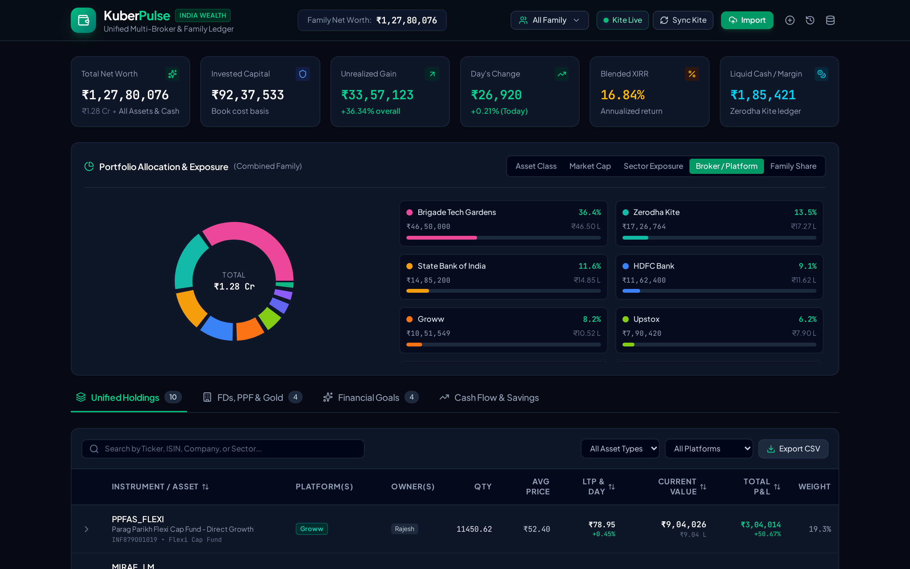
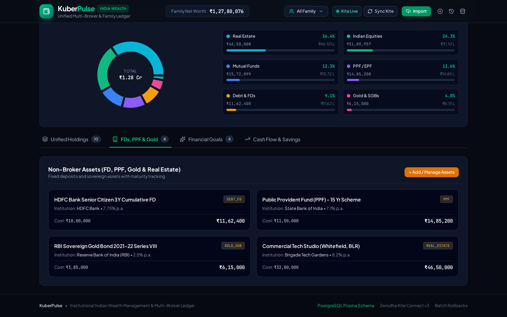
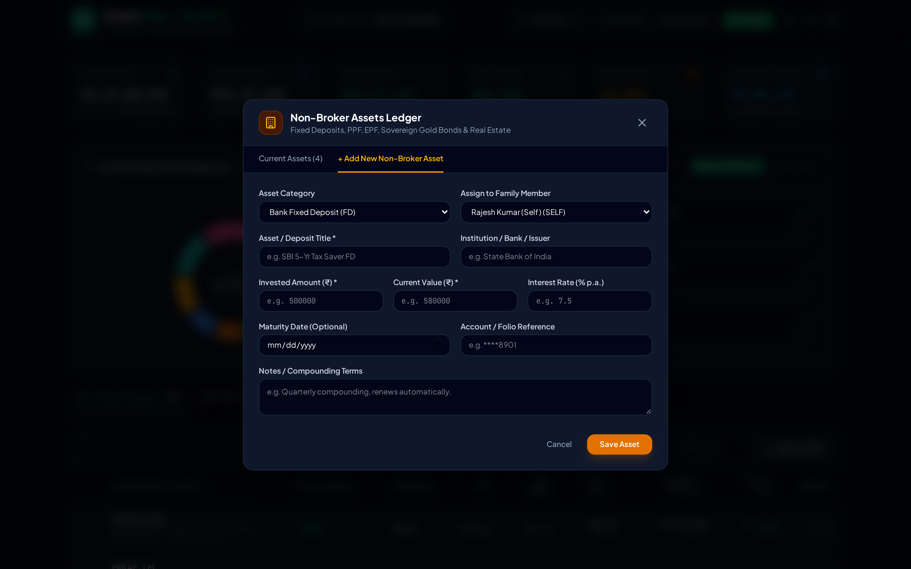
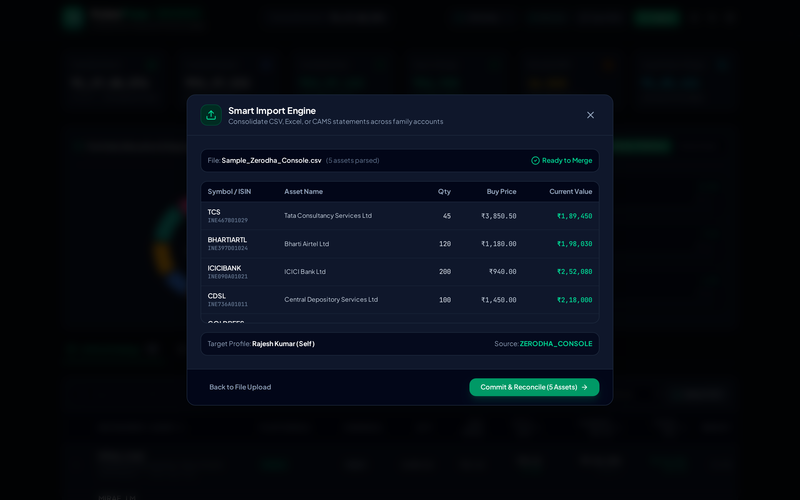
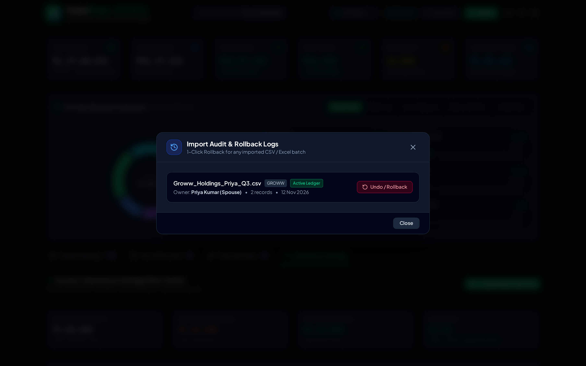
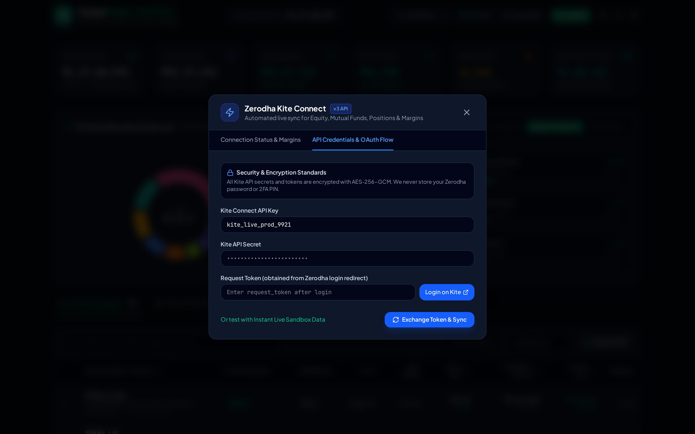
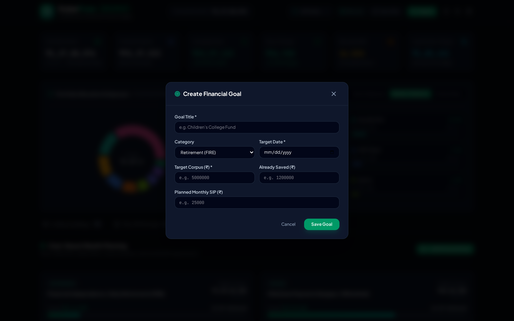
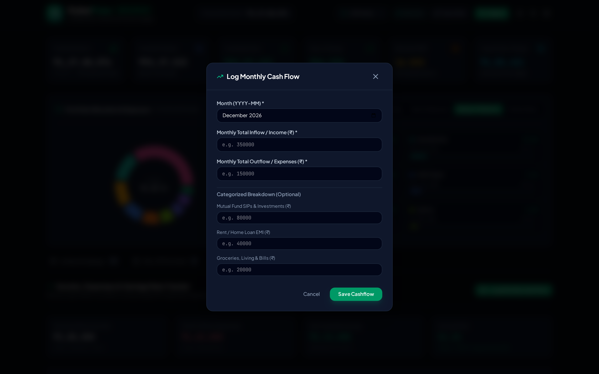
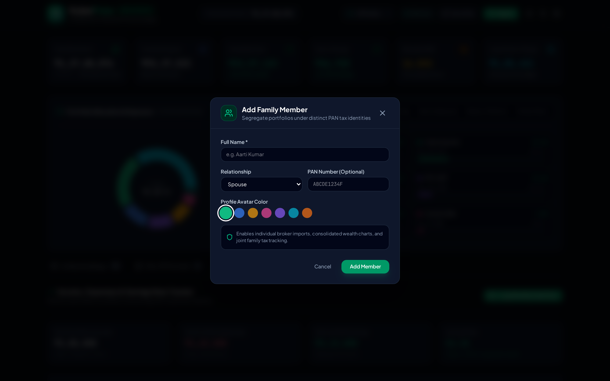
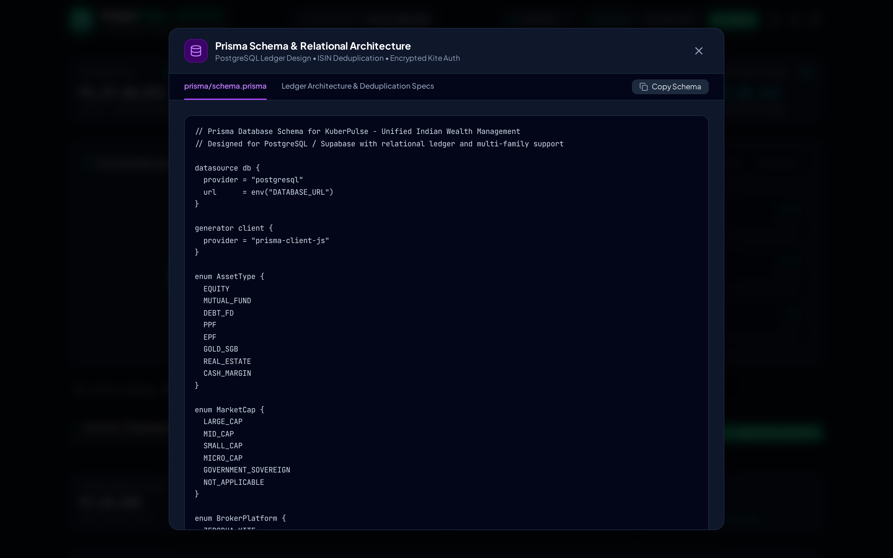

# KuberPulse — Indian Wealth & Multi-Broker Portfolio Tracker

**Current Release:** `v1.0.0-alpha.1` (First Alpha Release) · See [CHANGELOG.md](CHANGELOG.md)

**KuberPulse** is a unified personal finance and wealth management web & desktop application tailored for Indian retail investors and families. It consolidates investments across multiple brokers, Mutual Fund RTAs, and non-broker physical/sovereign assets into a single ledger with Indian numbering (`₹` en-IN formatting), ISIN-based deduplication, multi-PAN family tagging, persistent Express storage, and native Electron installers.

---

## App Screenshots

### 1. Unified Wealth Dashboard & Asset Allocation
Top summary KPI cards (**Total Net Worth**, **Invested Capital**, **Unrealized Gain**, **Day's Change**, **Blended XIRR**, and **Liquid Cash Margin**) alongside interactive donut charts segmented by Asset Class, Market Cap, Sector Exposure, Broker/Platform, and Family Share.


### 2. Broker & Platform Allocation Breakdown
Interactive exposure view breaking down net worth across Zerodha Kite, Groww, Upstox, banks, and direct assets.



### 3. Multi-Broker Holdings & ISIN Deduplication
Searchable and sortable holdings table that automatically merges duplicate securities across platforms (e.g., `RELIANCE` held across both **Zerodha Kite** and **Groww**) using weighted-average buy prices, with expandable per-broker ledger drawers.


### 4. Non-Broker Assets (FDs, PPF, Gold & Real Estate)
Dedicated ledger for fixed deposits, Public Provident Fund (PPF), RBI Sovereign Gold Bonds (SGBs), and real estate with institution metadata, annual interest rates, and cost vs. current valuation.



#### Add Non-Broker Asset Form
Record bank fixed deposits, PPF/EPF balances, Sovereign Gold Bonds, or real estate assigned to specific family members.



### 5. Smart Import Engine (CSV / Excel / CAMS CAS)
Drag-and-drop import wizard supporting **Zerodha Console**, **Groww**, **Upstox**, and **CAMS / KFintech CAS** exports with family member PAN assignment and downloadable test samples.


#### CSV / XLSX Reconciliation Preview
Automatic ticker/ISIN normalization and pre-commit preview table before merging assets into the unified ledger.



### 6. Import Audit Logs & 1-Click Batch Rollback
Track every uploaded spreadsheet batch with owner tagging, record counts, and instant 1-click **Undo / Rollback** to safely revert faulty imports without corrupting the historical ledger.



### 7. Zerodha Kite Connect v3 Integration
Inspect live Kite connection status, available cash, and utilised SPAN margins, with instant sync controls.


#### Kite API Credentials & OAuth Flow
Configure Kite Connect API keys, handle daily 06:00 AM IST token expirations, and run OAuth request token exchanges.



### 8. Goal-Based Wealth Planning
Track long-term milestones such as Financial Independence (FIRE), Home Down Payment, Children's Education, and Emergency Runway with corpus progress bars, shortfall calculations, and recommended monthly SIPs.


#### Create Financial Goal
Define new target corpus milestones with target dates and monthly SIP plans.



### 9. Cash Flow & Savings Rate Tracker
Log monthly inflows and categorized outflows (Mutual Fund SIPs, Rent/EMI, Groceries, Utilities) to track net investible surplus and savings velocity.


#### Log Monthly Cash Flow
Record monthly income, total outflow, and categorized expense breakdowns.



### 10. Multi-PAN Family Sub-Profiles
Add family members (`Self`, `Spouse`, `Parent`, `Child`, `HUF`) with distinct PAN tax identities and color-coded avatars to filter or consolidate household wealth.



### 11. PostgreSQL Prisma Schema & Architecture Viewer
Inspect and copy the relational `prisma/schema.prisma` blueprint and ledger deduplication specifications directly inside the app.



---

## Core Features

* **Zerodha Kite Connect Sync**: OAuth login URL generation, margin inspection, and live sync simulation for equities, ETFs, positions, and cash balances.
* **Multi-Platform Import & Reconciliation**:
  * Parsers for **Zerodha Console**, **Groww**, **Upstox**, and **CAMS / KFintech CAS** via `papaparse` and `xlsx`.
  * Automatic **ISIN & Ticker deduplication** calculating weighted-average buy prices across brokers.
  * **Import Audit & Rollback Logs** allowing instant 1-click undo of any uploaded batch.
* **Family Multi-Profile Tagging**: Segregate and filter holdings across `Self`, `Spouse`, `Parent`, `Child`, and `HUF` accounts, or view the combined family balance sheet.
* **Non-Broker Asset Ledger**: Track **Bank Fixed Deposits (FDs)**, **PPF**, **EPF**, **RBI Sovereign Gold Bonds (SGBs)**, and **Real Estate** with interest rates and maturity dates.
* **Institutional Indian UX**: Dark fintech theme with tabular monospace numerals, `en-IN` Rupee formatting (`₹1,84,25,840`), compact Lakh/Crore notation (`₹1.84 Cr`), and CSV export.
* **PostgreSQL Relational Schema**: Full Prisma schema (`prisma/schema.prisma`) modeling `User`, `FamilyMember`, `BrokerConnection`, `Asset`, `Holding`, `Transaction`, `ManualAsset`, `ImportLog`, `FinancialGoal`, and `CashflowRecord`.

---

## Tech Stack

* **Frontend**: React 19, TypeScript, Vite, Tailwind CSS v4, Lucide Icons
* **Data Visualization**: Recharts (interactive allocation donut charts)
* **File Parsing**: `papaparse` (CSV), `xlsx` (Excel spreadsheets)
* **Database Blueprint**: Prisma ORM (`prisma/schema.prisma`) for PostgreSQL / Supabase

---

## Getting Started

### 1. Install Dependencies
```bash
npm install
```

### 2. Run Development Server (Full-Stack Express + Vite)
```bash
npm run dev
```
The app runs at `http://localhost:3000` with persistent local ledger storage (`~/.kuberpulse/kuberpulse-ledger.json`) and AES-256-GCM encrypted Zerodha Kite credential storage.

### 3. Build for Production
```bash
npm run build
```

### 4. Type Check / Lint
```bash
npm run lint
```

---

## Self-Hosted Desktop Auto-Installer (Windows / macOS / Linux)

KuberPulse includes an **Electron** wrapper (`electron/main.cjs`) and **`electron-builder`** configuration (`electron-builder.yml`) that bundles the React UI, local Express server, and encrypted local ledger into native double-click installers:

```bash
# 1. Install dependencies (includes electron & electron-builder)
npm install

# 2. Build native installer for your OS (output generated in ./release/)
npm run dist:win     # Windows NSIS Setup (.exe) & Portable .exe
npm run dist:mac     # macOS Universal (.dmg & .zip)
npm run dist:linux   # Linux (.AppImage & .deb)
```

* **Local Data Persistence**: Desktop builds automatically persist all holdings, imports, goals, cash flows, and encrypted Kite tokens inside your OS application data folder (`app.getPath('userData')`), accessible anytime from **KuberPulse → Open Local Data Folder**.
* **Kite OAuth Compatibility**: The embedded server prefers `http://localhost:3000` so Zerodha Kite Connect redirect URLs work locally out of the box.

---

## GitHub Alpha Releases (`v1.0.0-alpha.1`)

KuberPulse includes a pre-configured GitHub Actions release pipeline (`.github/workflows/release.yml`) that verifies TypeScript + bundle compilation and automatically builds Windows (`.exe`), macOS (`.dmg`/`.zip`), and Linux (`.AppImage`/`.deb`) installers whenever a `v*` tag is pushed:

```bash
# Link your GitHub repository and push the main branch + v1.0.0-alpha.1 release tag
git remote add origin https://github.com/<your-username>/kuberpulse.git
git push -u origin main --follow-tags
```

Tags containing `-alpha`, `-beta`, or `-rc` automatically publish as a **GitHub Pre-release** with release notes sourced from `CHANGELOG.md` and attached cross-platform desktop installers.

---

## Project Structure

```text
├── .github/
│   └── workflows/
│       └── release.yml                # Automated CI verification & Electron GitHub Release workflow
├── build/
│   └── icon.svg                       # Desktop application icon
├── docs/
│   └── screenshots/                   # Application screenshots
├── electron/
│   ├── main.cjs                       # Electron main window & embedded server launcher
│   └── preload.cjs                    # Secure contextBridge preload script
├── prisma/
│   └── schema.prisma                  # PostgreSQL relational schema
├── server/
│   ├── crypto.ts                      # AES-256-GCM local encryption & Kite checksums
│   ├── kiteApi.ts                     # Zerodha Kite Connect v3 REST token & holdings sync
│   └── storage.ts                     # Atomic JSON ledger persistence
├── src/
│   ├── components/
│   │   ├── architecture/              # Prisma schema & architecture viewer modal
│   │   ├── cashflow/                  # Income vs. expenses & savings rate tracker
│   │   ├── dashboard/                 # Summary KPI cards & allocation charts
│   │   ├── family/                    # Family member PAN profile management
│   │   ├── goals/                     # Financial goal planner
│   │   ├── holdings/                  # Searchable, expandable holdings table
│   │   ├── import/                    # Smart Import Wizard & Rollback History
│   │   ├── kite/                      # Zerodha Kite Connect modal
│   │   ├── layout/                    # Top navigation bar
│   │   └── manual/                    # Non-broker asset modal (FD, PPF, Gold)
│   ├── lib/
│   │   ├── financialMath.ts           # XIRR, ISIN consolidation & allocation math
│   │   ├── formatters.ts              # ₹ en-IN & Lakh/Crore formatters
│   │   └── sampleData.ts              # Seeded Indian retail portfolio dataset
│   ├── services/
│   │   ├── importParser.ts            # CSV/XLSX normalization & sample generators
│   │   └── kiteConnect.ts             # Kite Connect v3 OAuth & sync helpers
│   ├── types/
│   │   └── index.ts                   # Core TypeScript interfaces
│   ├── App.tsx
│   └── main.tsx
├── CHANGELOG.md                       # Release notes & Alpha status
├── electron-builder.yml               # Cross-platform installer config (NSIS, DMG, AppImage)
├── server.ts                          # Express + Vite unified backend entrypoint
└── package.json
```
